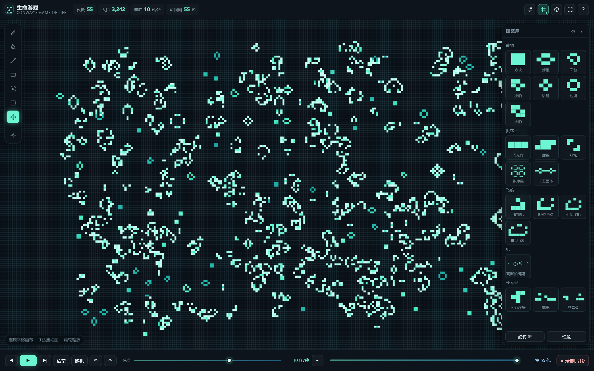

# 生命游戏 · Conway's Game of Life

一个跑在浏览器里的康威生命游戏模拟器：**环形（环面）世界**、可调比例与尺寸、无限平移视角、
图案库、时间回溯、快照与片段回放，还能一键进全屏纯画布观察。

**在线试玩：** https://for-xiaoyi.github.io/My-GameOfLife/



*亮青色的格子是刚出生的，越暗说明这一格活得越久。（截图来自较早版本，顶栏现在已改成图标）*

## 开始玩

| 方式 | 怎么做 | 适合 |
| --- | --- | --- |
| **在线版** | 打开上面的链接 | 立刻玩，不用下载 |
| **单文件** | 双击根目录的 `生命游戏.html` | 离线玩、发给别人 |
| 自己构建 | `pnpm install` → `pnpm build` | 改代码 |

`生命游戏.html` 把 JS 和 CSS 全部内联进了一个文件，双击就能跑，断网也能玩。

## 界面一览

顶栏只有五个图标：

| 图标 | 作用 |
| --- | --- |
| **画布设置** | 世界比例、长边尺寸、边界规则，带实时预览 |
| **网格** | 三态循环：关闭 → 网格 → 网格 + 世界边界参考线 |
| **内容库** | 一个窗口四个页签：时刻（存档）、时段（片段）、分享、导入导出 |
| **全屏** | 只留画布观察，`Esc` 退出 |
| **帮助** | 操作说明：左边选主题（画布 / 演化 / 创造 / 图案库 / 内容库），右边的按键与说明逐行对齐 |

## 玩法

### 画布设置（比例 / 尺寸 / 边界）

世界是**有限但无接缝**的环面。点顶栏「画布设置」可以一次性调整：

- **比例**：16:9 / 21:9 / 4:3 / 1:1 / 9:16。世界尺寸跟着比例走，
  例如长边 1024 + 16:9 = 1024 × 576，9:16 = 576 × 1024。
- **长边**：512 / 1024 / 1920 / 2048 / 2560。
- **匹配屏幕**：读取显示器物理分辨率，自动挑最接近的比例与长边。
- **1:1 像素**：把缩放锁到「一个细胞 = 一个物理像素」，并关掉插值，画面最锐利。
- **边界**：环绕（上下左右相接）或死亡（越界即消失）。
- **实时预览**：窗口右侧用你当前的图案按目标比例画出来，带世界边界虚线；改设置只动预览，
  点「应用」才重建。重建会**保留当前图案居中放入**新世界，缩小时超出部分被裁切，
  回溯历史会重置——怕丢可以先点「先存快照」；画布上有内容时点「应用」会先确认一次。

### 视角

- 打开就是平移工具，拖哪看哪；滚轮缩放（0.03×–64×，锚在光标处）、双指捏合。
- **环绕模式下画面可以无限平移**：拖到世界边界之外，内容从对侧接上来，永远撞不到墙。
  缩到极限时大约能看到 **2×2 组**世界，再往里缩没有意义，所以有下限。
- **回正**：`Shift+0`（或 `Ctrl+0`），保持当前缩放把世界转回画面中央——平移工具按钮的提示里也写着这条。
- `0` 是「适应全图」，会改变缩放把整个世界装进视口——和回正是两回事。
- **世界边界参考线**：把顶栏网格按钮点到第三档，每过一个世界周期会出现一条很淡的虚线，
  用来判断「这一张世界到哪里为止」。

### 演化与编辑

- **演化**：底栏 ▶ 播放/暂停（`Space` 也是）、单步、速度滑杆 0.1–120 代/秒，右边 ∞ 是不限速。
  打开内容库、帮助、画布设置这类会盖住画布的界面时，演化会**自动暂停**，
  关掉后自动恢复成打开之前的状态（本来在跑就接着跑，本来是停的就还是停）——
  不用担心看一会儿回来已经跑过去几百代。
- **回溯深度**：底栏最右边的「回溯」下拉框，可以选 500 / 1000 / 3000 / 10000 / 20000 代，
  或者「不限」只受 32 MB 内存上限约束；鼠标停在上面能看到「已记录多少代、占多少内存」，改完立刻生效。
- **创造**：右侧图案库点一个图案 → 在画布上点一下放下；`R` 旋转、`M` 镜像，
  半透明幽灵预览跟着鼠标走。环绕模式下贴着接缝也能放，预览会绕到对侧显示。
- **画笔 / 橡皮 / 直线 / 矩形**：左侧工具栏，快捷键 `B E I U`。
  **连续笔迹跨过接缝时不会断，也不会拉出一条横贯世界的直线**——轨迹在环面上连续推进，
  落格时才绕回。
- **笔刷大小**：最大 31×31，`Ctrl`+滚轮或 `[` `]` 调；滚轮本身始终是缩放。
- **选择框**：按 `K` 框住一块区域 → 底栏出现「删除 / 存为图案 / 取消」。
  - **框可以跨过接缝**：从右边界拖出去，框会同时在左右两侧显示，删除、存图案、搬走都按
    「一条连续区间」处理；
  - 拖框的边或角改大小，拖框内整体搬走；`Alt`+拖框内只挪框不动细胞；`Shift` 拖动重新框选；
  - 按住 `Ctrl` 再拖可以加第二块、第三块，几块会合成一张更复杂的图案；
  - `Del` 删框里的细胞，`Esc` 退出选择框；这些操作都能 `Ctrl+Z` 撤销。
- **图案库可编辑**：点图案库右上角 `⚙` 进入编辑模式——拖分类标题排序、拖图案方块换位置，
  拖动时是**指针驱动**的浮动预览，被拖走的方块会立刻让出位置，不留空洞。
  还能改分类名、删分类、把图案收进「仓库」再从仓库取回。这些改动存在浏览器里。

### 记录与分享

- **时间回溯**：底栏时间轴拖回任意一代，`←/→` 单代微调。记录的是每代**翻转了哪些格子**
  （增量编码），每 64 代存一个关键帧，所以拖到第 1 代和第 2999 代一样快；默认保留 3000 代，
  另外还有 32 MB 内存上限，谁先到就丢最早的记录。
- **快照（时刻）**：内容库第一个页签里「保存当前」，连世界、代数、镜头一起记下来。
  点缩略图会**先打开预览**（可以缩放、平移；缩放有下限，不会缩成一个小点），确认后再点「载入到画布」——
  载入会覆盖当前画面并重置回溯历史，所以会先问一句；删除同样要确认。关掉预览会回到内容库，不会直接掉回画布。
- **片段（时段）**：底栏「● 录制片段」开始录，演化一阵再停，它就成了一段可以播放、
  拖动进度条的小电影，在内容库第二个页签里。播放器一屏放得下，画面可以滚轮缩放、拖动平移，
  「收起」把操作栏藏起来只看画面（底部浮一个「▴ 操作栏」点回来），「全屏」进一步铺满屏幕；关掉回到内容库。
- **分享**：内容库「分享画面」可以存 PNG、复制一条能还原当前画面的链接（世界内容压成 RLE
  塞在 `#` 后面，不经过服务器），链接里带上了世界宽高。
- **自动存档**：存在浏览器本地，换浏览器或清缓存会丢；重要画面建议存 PNG 或复制分享链接。

### 全屏观察

点顶栏全屏图标或按 `F`：顶栏、底栏、图案库、工具栏全部隐藏，只留画布，
并自动切到平移工具避免误画。鼠标移动会在底部浮现一个胶囊浮层
（播放/暂停 · 代数 · 人口 · 退出），静止 2.5 秒自动淡出。`Esc` 退出。
浏览器拒绝真全屏时会降级成纯 CSS 沉浸模式，行为一致。

### 手机上

单指绘制、双指捏合缩放、双指拖动平移；窄屏会自动收起图案库。拖拽排序同样支持触摸。

## 快捷键

| 键 | 作用 | 键 | 作用 |
| --- | --- | --- | --- |
| `Space` | 播放 / 暂停 | `B` `E` | 画笔 / 橡皮 |
| `←` `→` | 后退 / 前进一代 | `I` `U` | 直线 / 矩形 |
| `↑` `↓` | 放大 / 缩小 | `S` `K` | 摆放图案 / 选择框 |
| `0` | 适应全图 | `R` `M` | 旋转 / 镜像 |
| `Shift+0` 或 `Ctrl+0` | 回正视角（不改缩放） | `G` | 显示三态循环 |
| `[` `]` | 笔刷变小 / 变大 | `F` | 全屏观察 |
| `Ctrl+Z` | 撤销（加 `Shift` 重做） | `Del` | 删选区内容 / 清空世界 |
| `Esc` | 退出选择框 / 退出全屏 | | |

## 一些实现上的取舍

- **一步演化是位并行的**：一整行细胞压进 32 位整数，用「左右邻居 XOR、上下邻居 AND」
  这类位运算一次算 32 格。`scripts/selftest.ts` 里用暴力实现在 4 种尺寸 ×
  环绕/死亡 × 3 个随机种子上连跑 25 代对拍，250 项断言全过；本机稠密 1024² 约 1.6 ms/代。
- **时间回溯不做逆向计算**：规则本身不可逆，所以反过来「存每一代翻转了哪些格子」，
  每 64 代压一个关键帧兜住重放成本，拖到任意一代最多重放 64 步。
- **渲染不靠逐个画格子**：先把世界写进一块离屏像素缓冲（一格一个像素，查表取色），
  再一次性缩放贴到画布上；颜色按细胞存活时长取，新生的亮、活得久的暗。
- **环绕模式用「瓷砖」铺满**：把离屏位图当成可以无限重复的纹理（`createPattern` + 一次
  `fillRect`），相机偏移按世界周期取模。环面本身是周期的，所以瓷砖之间天然吻合，
  不需要拼接逻辑；缩放到 0.2× 以下会退回单张绘制，避免亚像素噪点。
- **跨接缝选区不换数据模型**：选区矩形允许 `x1` 超过世界宽度，读取格子时统一取模，
  于是「一个框跨两边」在数据上就是一条连续区间。拖拽用环面最短路径算增量，
  保证跨缝选区不超过半个世界，坐标去歧义永远只有一个解。
- **图案库排序不用 HTML5 拖拽**：HTML5 拖拽期间源元素不能移出布局，必然留下一个空洞；
  改成 pointer 事件 + 克隆节点做浮动预览，源方块可以立刻收起，落点用几何计算
  （按指针在网格里的行列算插入序号），因此不会来回抖。
- **世界尺寸非方形**：`World` 从一开始就是按 `width / height` 设计的，
  比例只影响尺寸换算，演化与回溯逻辑不需要区分方形还是长方形。

## 开发与自检

```bash
pnpm install          # 安装依赖（typescript / vite / esbuild）
pnpm typecheck        # tsc --noEmit
pnpm test             # node --experimental-strip-types scripts/selftest.ts
pnpm build            # 打包成单文件 生命游戏.html + docs/index.html
node scripts/check.mjs      # 用 CDP 驱动真浏览器做端到端冒烟
node scripts/bench.mjs      # 性能基准
```

`scripts/` 里还有图案生成（`gen-patterns.mjs`，从 `tools/patterns/*.rle` 生成图案库）、
Pages 线上自检（`check-pages*.mjs`）和发布脚本（`publish-github.mjs`）。

## 宣传片

**成片：** [Releases · 宣传片 v1](https://github.com/For-XiaoYi/My-GameOfLife/releases/download/promo-v1/promo.mp4)
（1920×1080，30fps，61.5 秒，8.9 MB，带配乐）
　·　首帧海报：[`assets/promo-poster.png`](assets/promo-poster.png)
　·　一图看全片：[`assets/promo-storyboard.png`](assets/promo-storyboard.png)（12 个关键帧，带时间点）

> 视频没放进仓库：几十 MB 的二进制塞进 git 会让每次 clone 都变慢，所以走 Release 附件，
> 上面那个链接点开就能直接下载。`assets/` 里的海报和分镜图是普通文件，clone 下来就有。

片子的结构是「先讲规则，再拆组件」：标题 → 四条规则 → 静物 → 振荡子 → 滑翔机（定格）→
滑翔机（实机录像）→ 滑翔枪 → 逻辑电路 → 结尾。功能演示不是单独一段，而是以真实操作短片的
形式穿插在组件之间，所以看到的是「这个东西真的能在那个界面里摆出来」。

**声音**：有一条自己合成的配乐，没有旁白——`scripts/make-music.mjs` 用纯代码做加法合成：
暗色 pad 铺底、随段落逐渐加快的琶音、功能段进鼓、转场呼啸与上扬 riser，最后收在一个大三和弦上。
没用任何采样库，想调节奏、换和弦、改音量，改脚本再跑一次就行（随机数有固定种子，跑出来的结果每次都一样）：

```bash
node scripts/make-music.mjs       # 重新生成 promo/public/music/score.wav
```

配乐由 `src/Promo.tsx` 里的 `<Audio src={staticFile('music/score.wav')} />` 挂到整条时间线上。

## 在自己电脑上改这支片子

```bash
git clone https://github.com/For-XiaoYi/My-GameOfLife.git
cd My-GameOfLife
git lfs pull                        # 只有用 LFS 时才有这一步，见下

cd promo
pnpm install                        # 需要 Node 20+；依赖包括 remotion 4.0.539 / react 19
pnpm studio                         # 打开实时预览：拖时间轴、改代码即时重渲
pnpm render                         # 直接出 out/promo.mp4
```

想改成竖屏（发抖音/朋友圈）：把 `src/Root.tsx`（或 `src/index.tsx` 里注册组合的地方）
`1920×1080` 改成 `1080×1920`，场景里的两栏布局会挤，`width` 记得一起改小。

工程里都齐了，clone 下来就能直接渲：

| 目录 | 内容 |
| --- | --- |
| `promo/src/scenes/` | 六个场景：标题 / 规则 / 涌现 / 功能 / 回溯 / 结尾 |
| `promo/src/lib/life.ts` | 真的生命游戏规则（视频里所有细胞演化都是现场算的） |
| `promo/src/assets/patterns.json` | 20 个预设图案的位图，由 `scripts/dump-patterns.mjs` 从主程序里导出 |
| `promo/public/` | 界面截图、背景汤、`music/score.wav`（8.6 MB，已进仓库） |
| `scripts/make-music.mjs` | 生成配乐 |
| `scripts/dump-patterns.mjs` | 重新从 `生命游戏.html` 里导出图案数据 |
| `scripts/make-storyboard.mjs` | 把关键帧拼成 `assets/promo-storyboard.png` |

渲染会用到浏览器：`promo/remotion.config.ts` 会自动在常见路径里找 Chrome / Edge，
找不到就让 Remotion 自己下载 headless shell，**不用手改路径**。想指定自己的浏览器，
设环境变量 `CHROME_PATH` 即可。

- 界面镜头是脚本用 CDP 拍下的真实界面（`scripts/shoot-promo*.mjs`），存在 `promo/public/`；
  图案动画则由 `src/lib/life.ts` 现算每一代的位图，所以视频里的演化是真的。
