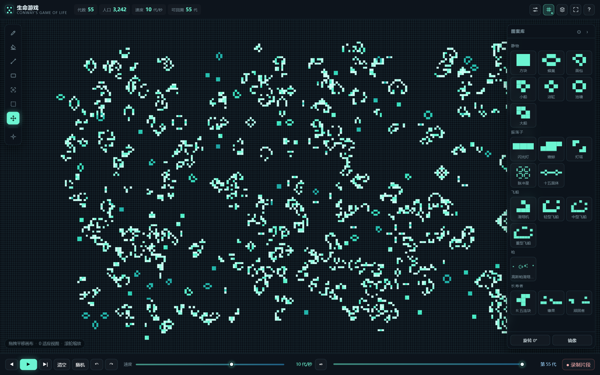

# 生命游戏 · Conway's Game of Life

一个跑在浏览器里的康威生命游戏模拟器：**环形（环面）世界**、可调比例与尺寸、无限平移视角、
图案库、时间回溯、快照与片段回放，还能一键进全屏纯画布观察。

**在线试玩：** https://for-xiaoyi.github.io/My-GameOfLife/



*亮青色的格子是刚出生的，越暗说明这一格活得越久。（截图来自较早版本，顶栏现在已改成图标）*

> 仓库里哪个目录放什么、哪些文件会被发布：[`FILES.md`](FILES.md) 有完整地图。

## 开始玩

| 方式 | 怎么做 | 适合 |
| --- | --- | --- |
| **在线版** | 打开上面的链接 | 立刻玩，不用下载 |
| **单文件** | 双击根目录的 `生命游戏.html` | 离线玩、发给别人 |
| 自己构建 | `pnpm install` → `pnpm build` | 改代码 |

`生命游戏.html` 把 JS 和 CSS 全部内联进了一个文件，双击就能跑，断网也能玩。

## 界面一览

顶栏只有六个图标：

| 图标 | 作用 |
| --- | --- |
| **声音** | 点一下静音 / 恢复（`Ctrl+M` 同效），`Shift`+点击打开音量与状态面板 |
| **画布设置** | 世界比例、长边尺寸、边界规则，带实时预览 |
| **网格** | 三态循环：关闭 → 网格 → 网格 + 世界边界参考线 |
| **内容库** | 一个窗口四个页签：时刻（存档）、时段（片段）、分享、导入导出 |
| **全屏** | 只留画布观察，`Esc` 退出 |
| **帮助** | 操作说明：左边选主题（画布 / 演化 / 创造 / 图案库 / 内容库），右边的按键与说明逐行对齐 |

## 玩法

### 画布设置（比例 / 尺寸 / 边界）

世界是**有限但无接缝**的环面。点顶栏「画布设置」可以一次性调整：

- **比例**：16:9 / 21:9 / 4:3 / 1:1 / 9:16。世界尺寸跟着比例走，
  例如长边 1024 + 16:9 = 1024 × 576，9:16 = 576 × 1024。
- **长边**：512 / 1024 / 1920 / 2048 / 2560。
- **匹配屏幕**：读取显示器物理分辨率，自动挑最接近的比例与长边。
- **1:1 像素**：把缩放锁到「一个细胞 = 一个物理像素」，并关掉插值，画面最锐利。
- **边界**：环绕（上下左右相接）或死亡（越界即消失）。
- **实时预览**：窗口右侧用你当前的图案按目标比例画出来，带世界边界虚线；改设置只动预览，
  点「应用」才重建。重建会**保留当前图案居中放入**新世界，缩小时超出部分被裁切，
  回溯历史会重置——怕丢可以先点「先存快照」；画布上有内容时点「应用」会先确认一次。

### 视角

- 打开就是平移工具，拖哪看哪；滚轮缩放（0.03×–64×，锚在光标处）、双指捏合。
- **环绕模式下画面可以无限平移**：拖到世界边界之外，内容从对侧接上来，永远撞不到墙。
  缩到极限时大约能看到 **2×2 组**世界，再往里缩没有意义，所以有下限。
- **回正**：`Shift+0`（或 `Ctrl+0`），保持当前缩放把世界转回画面中央——平移工具按钮的提示里也写着这条。
- `0` 是「适应全图」，会改变缩放把整个世界装进视口——和回正是两回事。
- **世界边界参考线**：把顶栏网格按钮点到第三档，每过一个世界周期会出现一条很淡的虚线，
  用来判断「这一张世界到哪里为止」。

### 演化与编辑

- **演化**：底栏 ▶ 播放/暂停（`Space` 也是）、单步、速度滑杆 0.1–120 代/秒，右边 ∞ 是不限速。
  打开内容库、帮助、画布设置这类会盖住画布的界面时，演化会**自动暂停**，
  关掉后自动恢复成打开之前的状态（本来在跑就接着跑，本来是停的就还是停）——
  不用担心看一会儿回来已经跑过去几百代。
- **回溯深度**：底栏最右边的「回溯」下拉框，可以选 500 / 1000 / 3000 / 10000 / 20000 代，
  或者「不限」只受 32 MB 内存上限约束；鼠标停在上面能看到「已记录多少代、占多少内存」，改完立刻生效。
- **创造**：右侧图案库点一个图案 → 在画布上点一下放下；`R` 旋转、`M` 镜像，
  半透明幽灵预览跟着鼠标走。环绕模式下贴着接缝也能放，预览会绕到对侧显示。
- **画笔 / 橡皮 / 直线 / 矩形**：左侧工具栏，快捷键 `B E I U`。
  **连续笔迹跨过接缝时不会断，也不会拉出一条横贯世界的直线**——轨迹在环面上连续推进，
  落格时才绕回。
- **笔刷大小**：最大 31×31，`Ctrl`+滚轮或 `[` `]` 调；滚轮本身始终是缩放。
- **选择框**：按 `K` 框住一块区域 → 底栏出现「删除 / 存为图案 / 取消」。
  - **框可以跨过接缝**：从右边界拖出去，框会同时在左右两侧显示，删除、存图案、搬走都按
    「一条连续区间」处理；
  - 拖框的边或角改大小，拖框内整体搬走；`Alt`+拖框内只挪框不动细胞；`Shift` 拖动重新框选；
  - 按住 `Ctrl` 再拖可以加第二块、第三块，几块会合成一张更复杂的图案；
  - `Del` 删框里的细胞，`Esc` 退出选择框；这些操作都能 `Ctrl+Z` 撤销。
- **图案库可编辑**：点图案库右上角 `⚙` 进入编辑模式——拖分类标题排序、拖图案方块换位置，
  拖动时是**指针驱动**的浮动预览，被拖走的方块会立刻让出位置，不留空洞。
  还能改分类名、删分类、把图案收进「仓库」再从仓库取回。这些改动存在浏览器里。

### 记录与分享

- **时间回溯**：底栏时间轴拖回任意一代，`←/→` 单代微调。记录的是每代**翻转了哪些格子**
  （增量编码），每 64 代存一个关键帧，所以拖到第 1 代和第 2999 代一样快；默认保留 3000 代，
  另外还有 32 MB 内存上限，谁先到就丢最早的记录。
- **快照（时刻）**：内容库第一个页签里「保存当前」，连世界、代数、镜头一起记下来。
  点缩略图会**先打开预览**（可以缩放、平移；缩放有下限，不会缩成一个小点），确认后再点「载入到画布」——
  载入会覆盖当前画面并重置回溯历史，所以会先问一句；删除同样要确认。关掉预览会回到内容库，不会直接掉回画布。
- **片段（时段）**：底栏「● 录制片段」开始录，演化一阵再停，它就成了一段可以播放、
  拖动进度条的小电影，在内容库第二个页签里。播放器一屏放得下，画面可以滚轮缩放、拖动平移，
  「收起」把操作栏藏起来只看画面（底部浮一个「▴ 操作栏」点回来），「全屏」进一步铺满屏幕；关掉回到内容库。
- **分享**：内容库「分享画面」可以存 PNG、复制一条能还原当前画面的链接（世界内容压成 RLE
  塞在 `#` 后面，不经过服务器），链接里带上了世界宽高。
- **自动存档**：存在浏览器本地，换浏览器或清缓存会丢；重要画面建议存 PNG 或复制分享链接。

### 全屏观察

点顶栏全屏图标或按 `F`：顶栏、底栏、图案库、工具栏全部隐藏，只留画布，
并自动切到平移工具避免误画。鼠标移动会在底部浮现一个胶囊浮层
（播放/暂停 · 代数 · 人口 · 退出），静止 2.5 秒自动淡出。`Esc` 退出。
浏览器拒绝真全屏时会降级成纯 CSS 沉浸模式，行为一致。

### 手机上

单指绘制、双指捏合缩放、双指拖动平移；窄屏会自动收起图案库（选完图案也会自己收起）。拖拽排序同样支持触摸。

### 声音

音乐是**现场合成**的，不加载任何音频文件（单文件版断网也有）：和宣传片同一套
Am–F–C–G 和声与 pad / pluck / bass / kick / hat 的音色，但节奏与配器跟着画布里的生命走。

**一键静音**：点顶栏的喇叭（或按 `Ctrl` + `M`）立刻静音，再点恢复；`Shift` + 点击喇叭
（或右键）才打开声音设置——里面能调音乐 / 音效音量，并实时看到四个状态、BPM、人口变化率
和三条强度条。

| 状态 | 什么时候 | 听起来 |
| --- | --- | --- |
| **死寂** | 画布上一个细胞都没有 | 一下一下的**微弱心跳**（lub-dub），底下垫一记很深的长音，偶尔一次远处回声 |
| **平静** | 有细胞但人口平稳 | **动次打次**：正拍 1、3 底鼓，2、4 军鼓，八分踩镲，低音垫底；pad 压得很低，**没有长笛 / 琶音** |
| **绽放** | 细胞在快速变多（人口加速度变大） | 鼓更密（弱拍底鼓、踩镲加密）、速度从 ~105 提到 ~150 BPM、pad 变亮；仍然没有长笛 |
| **悠远** | 镜头拉远到能看见多个世界（缩放 < 0.55） | 慢到 ~64 BPM，鼓全撤，长混响 + 很稀疏的高音，像在俯瞰 |

**律动期**是叠在四个状态之上的一层：连着放图案、连着画很多细胞（或者随机播种一次），
鼓组会进入一段"加花"——**长笛（三角波琶音）这时才进来**，加上桶鼓打反拍、拍手替军鼓、
低音走切分、速度再抬一点。停手大约 5 秒后自己淡回正常算法，长笛也跟着退场，不会一直挂着。
声音设置里那条橙色的「律动」条就是它。

判断用的是人口的**一阶差分（每秒增长）和二阶差分（加速度）**，再除以人口取相对值：
一张大网的自然波动不会被误判成爆发，而放下一个滑翔枪会立刻把音乐点亮。状态之间
是连续过渡（速度、滤波、各层音量都平滑插值），不是硬切。

音效只挂在**手动操作**上（演化本身不出声，否则每秒几百代会糊成噪音）：放图案、删选区、
画/擦细胞、清空、随机播种（四颗骰子撞击声）、撤销/重做、播放/暂停、载入快照。
浏览器要求先有用户手势才能出声，所以音乐会在第一次点按或按键后淡入。

## 快捷键

| 键 | 作用 | 键 | 作用 |
| --- | --- | --- | --- |
| `Space` | 播放 / 暂停 | `B` `E` | 画笔 / 橡皮 |
| `←` `→` | 后退 / 前进一代 | `I` `U` | 直线 / 矩形 |
| `↑` `↓` | 放大 / 缩小 | `S` `K` | 摆放图案 / 选择框 |
| `0` | 适应全图 | `R` `M` | 旋转 / 镜像 |
| `Shift+0` 或 `Ctrl+0` | 回正视角（不改缩放） | `G` | 显示三态循环 |
| `[` `]` | 笔刷变小 / 变大 | `F` | 全屏观察 |
| `Ctrl+Z` | 撤销（加 `Shift` 重做） | `Del` | 删选区内容 / 清空世界 |
| `Ctrl+M` | 一键静音（再按恢复） | `Shift+点击喇叭` | 打开声音设置 |
| `Esc` | 退出选择框 / 退出全屏 | | |

## 一些实现上的取舍

- **一步演化是位并行的**：一整行细胞压进 32 位整数，用「左右邻居 XOR、上下邻居 AND」
  这类位运算一次算 32 格。`scripts/selftest.ts` 里用暴力实现在 4 种尺寸 ×
  环绕/死亡 × 3 个随机种子上连跑 25 代对拍，250 项断言全过；本机稠密 1024² 约 1.6 ms/代。
- **时间回溯不做逆向计算**：规则本身不可逆，所以反过来「存每一代翻转了哪些格子」，
  每 64 代压一个关键帧兜住重放成本，拖到任意一代最多重放 64 步。
- **渲染不靠逐个画格子**：先把世界写进一块离屏像素缓冲（一格一个像素，查表取色），
  再一次性缩放贴到画布上；颜色按细胞存活时长取，新生的亮、活得久的暗。
- **环绕模式用「瓷砖」铺满**：把离屏位图当成可以无限重复的纹理（`createPattern` + 一次
  `fillRect`），相机偏移按世界周期取模。环面本身是周期的，所以瓷砖之间天然吻合，
  不需要拼接逻辑；缩放到 0.2× 以下会退回单张绘制，避免亚像素噪点。
  纹理只在不重画离屏位图时复用——Chrome 的 `createPattern(canvas)` 是调用那一刻的快照，
  离屏画布之后更新，旧纹理不会跟着变，一直缓存会把整幅平铺画面冻住。
- **画面按需重绘**：暂停时画布内容会留着，没必要每帧重画，所以主循环只在播放、拖拽、
  有选区、以及指针/键盘操作后 1.2 秒内跑满 60fps，完全静止时降到每 250ms 一帧兜底。
  实测暂停状态下主线程占用从 47% 降到 3%（1600×890）；兜底帧保证漏掉某次重绘标记时，
  画面最多 250ms 后仍会自己刷新。
- **音乐是"调度"出来的，不是"播放"出来的**：`src/audio/engine.ts` 用 Web Audio 起一个
  30ms 的前瞻调度器（提前 180ms 把音符排进音频线程），和声、琶音、鼓都在运行时拼装，
  所以改 BPM / 加层 / 换混响只是改参数，不用换素材。混响是程序生成的噪声脉冲，
  不是采样。所有音符播完都会 `disconnect()` 把自己从音频图上摘掉，挂机几小时也不会越积越多。
  音量与模式判定都做了平滑，切状态时听不出台阶；静音时直接停掉调度，省电。
- **跨接缝选区不换数据模型**：选区矩形允许 `x1` 超过世界宽度，读取格子时统一取模，
  于是「一个框跨两边」在数据上就是一条连续区间。拖拽用环面最短路径算增量，
  保证跨缝选区不超过半个世界，坐标去歧义永远只有一个解。
- **图案库排序不用 HTML5 拖拽**：HTML5 拖拽期间源元素不能移出布局，必然留下一个空洞；
  改成 pointer 事件 + 克隆节点做浮动预览，源方块可以立刻收起，落点用几何计算
  （按指针在网格里的行列算插入序号），因此不会来回抖。
- **世界尺寸非方形**：`World` 从一开始就是按 `width / height` 设计的，
  比例只影响尺寸换算，演化与回溯逻辑不需要区分方形还是长方形。

## 开发与自检

```bash
pnpm install          # 安装依赖（typescript / vite / esbuild）
pnpm typecheck        # tsc --noEmit
pnpm test             # node --experimental-strip-types scripts/selftest.ts
pnpm build            # 打包成单文件 生命游戏.html + docs/index.html
node scripts/check.mjs      # 用 CDP 驱动真浏览器做端到端冒烟
node scripts/bench.mjs      # 性能基准
```

`scripts/` 里还有图案生成（`gen-patterns.mjs`，从 `tools/patterns/*.rle` 生成图案库）、
Pages 线上自检（`check-pages*.mjs`）和发布脚本（`publish-github.mjs`）。

## 宣传片

**成片：** [Releases · 宣传片 v1](https://github.com/For-XiaoYi/My-GameOfLife/releases/download/promo-v1/promo.mp4)
（旧版）
　·　首帧海报：[`assets/promo-poster.png`](assets/promo-poster.png)
　·　一图看全片：[`assets/promo-storyboard.png`](assets/promo-storyboard.png)（12 个关键帧，带时间点）
　·　本地最新渲染：`promo/out/promo-v15.mp4`（1920×1080，30fps，141 秒，带临时延长的配乐与音效）

> 视频没放进仓库：几十 MB 的二进制塞进 git 会让每次 clone 都变慢，所以走 Release 附件，
> 上面那个链接点开就能直接下载。`assets/` 里的海报和分镜图是普通文件，clone 下来就有。

片子的结构：标题 → 只有三条规则 → 由规则演变出秩序 → 秩序的产物：静物 → 震荡子 →
滑翔机（一个只有五格的图形）→ 滑翔机（实机录像）→ 更进一步（滑翔枪预告）→ 滑翔枪（1970 ·
无限增长）→ 碰撞/判断 → 黑屏「逻辑」→ 四种门 → 门阵列（LifeWiki 收录的图案）→ 图灵机 →
宏大结构 → 随机演化 → 结尾。后半段从「门」一路推到「机器」：四张逻辑门卡片（与 / 或 / 非 /
异或）每 1.5 秒进一张；门阵列是六张 LifeWiki 收录的图案（解复用器 / 触发器 / 存储单元 /
面包触发器 / 时钟 / 滑翔枪），2×3 向上滚，标「LifeWiki 图案」；Rendell 的图灵机用模拟器算出局部演化，
P59 炮阵、OTCA 元像素和通用图灵机用全图 + 实时小窗，太空填充者和栽培者整屏实时生长；
大神们的作品 5 张按「P59 → 太空填充者 → 栽培者 1 → OTCA 元像素 → 通用图灵机」排，
图灵机放最后，背景额外放大 1.18× 减少左边空白。
随机演化重做成「三句话 + 一颗骰子 → 回环模式的连续拉远镜头 → 结尾」，不再出现操作录屏。

v10 的改动集中在叙事：静物段先由「由规则演变出秩序」引入，再落到「秩序的产物：静物」；
震荡子、滑翔机、滑翔枪改用类名/阶段名做小标题；判断段收在「于是通过碰撞，我们有了基础的
逻辑」；门阵列不再提前出现「图灵机」，结尾问题改成「将不同的阵列组合起来，又会得到什么？」，
并把提问停留拉到 4 秒；P59 小窗换到用户框选的核心区；太空填充者的初始钻石居中；随机回环
末帧拉到 4×4（3×3 个世界 + 半圈循环空间），同时修掉镜头末尾的横向漂移；结尾把两枚含糊的
标签改成可核对的「单文件可下 / 手机能开」。

v11：震荡子标题改成与静物同款的「秩序的产物 + 92px 类名」；滑翔机实机录像改成
「选中 / 落子 / 按下播放 / 它自己就走了」逐步出现，和鼠标动作对齐；黑屏去掉「呢」；门阵列
四张卡改成 1 秒一张、第 5 秒提问、提问停 5 秒（场景 6→10 秒）；P59 小窗改用真正的密集区
（7488,3328）；大神们的作品从 3 张加到 5 张；结尾删掉手机相关标签，只留
「网页即开 / 单文件可下」。因为门阵列 +4 秒、大神展示 +10 秒，全片从 125 秒变成 139 秒；
配乐暂时是把原 125 秒在阵列/大神段做 loop 延长的临时版（`score-v11.mp3`）。

v12：门阵列改成「利用门，可以设计出 / 不同功能的阵列」，右侧六种功能图案
（解复用器 / 触发器 / 存储单元 / 面包触发器 / 时钟 / 滑翔枪）按 2×3 排、整列慢慢向上滚；
结尾提问时背景完全淡出、文字淡入；图灵机开场拆成「会得到 / 一台机器」两行，一台机器用 74px；
P59 小窗改回 3612,3860,480,270；栽培者 1 和 OTCA 元像素都换成真的在演化的动态片段
（栽培者整屏、OTCA 全图 + 局部小窗）；通用图灵机放到大神展示最后一张，背景放大 1.18×。

v13：门阵列场景 10→12 秒，右侧滚得更快，滚到第 3 行露出 3/4 才开始淡出，
左侧文字和右侧一起淡出，中间提问再淡入；门阵列第一行「利用门，可以设计出」缩到 30px，
第二行「不同功能的阵列」放大到 60px；碰撞段改成「于是，我们有了基础的逻辑」40px；
OTCA 背景改成 contain 展示完整方形图案，右上角小窗从 1.6× 一路拉远到 1×；
随机段的骰子改成从左抛入的抛物线；结尾换成「GitHub 开源 / 浏览器运行 / 本地化数据」。
配乐为 12 秒门阵列段延长到 `score-v12.mp3`（141 秒），仍是临时拼接版。

v14：规则正式改成三条（B3/S23）——死（少于 2 或超过 3）、活（2 或 3）、生（正好 3），
左边三条、右边用「孤单」「拥挤」两个例子演同一条死亡规则；门阵列标题改成「不同的反应，
定义不同的逻辑门」；黑屏提问改成和阵列提问同款的一行居中排版；骰子改回原地上抛、转一圈落回；
OTCA 小窗放大到 2.2× 再拉远；滑翔枪从门阵列移除，换成「半加器」（异或 + 与），
05 时钟 / 06 半加器；结尾、片头、正文里所有「四条规则」都改成「三条规则」。

v15（当前版）：黑屏提问恢复两行（问下去 / 那有了逻辑，/ 我们可以拿它来做什么？），
保留双拼色；门阵列提问参照它改成「问下去 + 两行 + 双拼色 + 短线」；05 时钟 / 06 半加器
改用静态图案，修掉画布空白；P59 右上角小窗从 1.5× 拉远到 1×；门阵列卡片 380→330 高。

## 抖音竖版（60 秒）

除了 16:9 完整版，工程里还有一条 **1080×1920、60 秒、9:16** 的抖音版：

- 成片：`promo/out/douyin-v2.mp4`（60.01 秒，1080×1920，30fps，H.264 + AAC，28.2 MB）
- 组合：`promo/src/douyin/DouyinPromo.tsx`，在 `src/index.tsx` 注册为 `PromoDouyin`
- 结构：`0–4s` 对撞冷开场 → `4–10s` 三条规则 → `10–14s` 滑翔机 → `14–20s` 滑翔枪 →
  `20–28s` 湮灭/判断 → `28–32s` 四种门 → `32–36s` 四台真实电路 → `36–44s` 图灵机 →
  `44–52s` P59 / UTM / 太空填充者 → `52–58s` 随机回环拉远 → `58–60s` 结尾
- 配乐：`scripts/make-douyin-music.mjs` 生成 60 秒独立配乐。**不采样、不抄旋律**，只借
  「开智的小曲」这类 AI 介绍片的底层结构：仪式感合唱、4 音动机、太鼓/808/拍手、
  段落 drop、随机段的心跳和音乐盒。输出 `promo/public/music/douyin.mp3`。
- 随机段用的是**竖屏回环录像** `clip-random-loop-vertical.mp4`，不是把横版裁一刀；
  重录命令：`node scripts/record-clips.mjs random-loop-vertical`。

> 竖版和横版是两条独立时间线，不是简单裁切。横版现在是 2 分 19 秒的完整叙事；
> 竖版把最抓人的对撞放到 0 秒，把真值表、静物、震荡子这些“图鉴式”内容移出 60 秒。

**声音**：有一条自己合成的配乐，没有旁白——`scripts/make-music.mjs` 用纯代码做加法合成：
暗色 pad 铺底、随段落逐渐加快的琶音、功能段进鼓、转场呼啸与上扬 riser，最后收在一个大三和弦上。
前 14 秒规则段刻意不铺鼓点，把声音让给三条规则的判定音效；黑屏提问处不断崖式掉音量；
门 / 门阵列的鼓点更重；随机段降到慢 pad + 60BPM 心跳。
没用任何采样库，想调节奏、换和弦、改音量，改脚本再跑一次就行（随机数有固定种子，跑出来的结果每次都一样）：

```bash
node scripts/make-music.mjs       # 先合成 125 秒 wav（中间产物）
# 压成 mp3 再进仓库（wav 21 MB，超出仓库树 12 MB 的单文件限制）
ffmpeg -i promo/public/music/score.wav -c:a libmp3lame -b:a 192k promo/public/music/score.mp3
node scripts/make-sfx.mjs         # 出生 / 死亡 / live / tick / whoosh / 碰撞 / 点击
```

v13 的成片 141 秒，用的是临时拼接的 `music/score-v12.mp3`：把原 125 秒 `score.mp3` 在
门阵列段 +6 秒、大神展示段 +10 秒做 loop 延长。原始 125 秒的 `score.mp3` 仍在，脚本没有改；
等下一轮整体重排后再替换。配乐由 `src/Promo.tsx` 里的 `<Audio src={staticFile('music/score-v12.mp3')} />`
挂在时间线上；规则段的生死音效是 `RulesScene` 里单独挂的 `<Audio>`，不混进配乐。

## 在自己电脑上改这支片子

```bash
git clone https://github.com/For-XiaoYi/My-GameOfLife.git
cd My-GameOfLife
git lfs pull                        # 只有用 LFS 时才有这一步，见下

cd promo
pnpm install                        # 需要 Node 20+；依赖包括 remotion 4.0.539 / react 19
pnpm studio                         # 打开实时预览：拖时间轴、改代码即时重渲
pnpm render                         # 直接出 out/promo.mp4
```

想改成竖屏（发抖音/朋友圈）：不要只改宽高——两栏布局会挤。工程里已有独立的竖版组合
`PromoDouyin`（见上面「抖音竖版」），它是一套单独重排的时间线。

工程里都齐了，clone 下来就能直接渲：

| 目录 | 内容 |
| --- | --- |
| `promo/src/scenes/` | 十六个场景：标题 / 规则 / 静物 / 振荡子 / 滑翔机 / 实机演示 / 滑翔枪预告 / 滑翔枪 / 判断 / 黑屏提问 / 逻辑门 / 门阵列 / 图灵机 / 宏大结构 / 随机演化 / 结尾 |
| `promo/src/lib/life.ts` | 真的生命游戏规则（视频里所有细胞演化都是现场算的；支持按轴回绕） |
| `promo/src/lib/gates.ts` | 四种门的真实反应帧（与 / 或 / 非 / 异或） |
| `promo/src/lib/circuits.ts` | 四台真实小电路（解复用器 / 触发器 / 存储单元 / 面包触发器）的坐标数据 |
| `promo/src/assets/patterns.json` | 20 个预设图案的位图，由 `scripts/dump-patterns.mjs` 从主程序里导出 |
| `promo/public/` | 界面截图、背景汤、`pattern-turing.png`、`grand-*.png`（含 `grand-breeder.png` / `grand-otca.png`）、`spacefiller-seed.png`、`clip-random-loop.mp4`、`clip-random-loop-vertical.mp4`、`clip-*-live.mp4`（图灵机 / P59 / 太空填充者 / 通用图灵机 / 栽培者 / OTCA）、`sfx/*.wav`、`music/score.mp3`（2.9 MB）、`music/score-v11.mp3`（3.2 MB，139 秒临时版）、`music/score-v12.mp3`（3.2 MB，141 秒临时版）、`music/douyin.mp3`（1.4 MB，60 秒竖版配乐） |
| `scripts/make-music.mjs` | 生成 125 秒完整版配乐（wav 中间产物） |
| `scripts/make-douyin-music.mjs` | 生成 60 秒竖版配乐（仪式合唱 / 太鼓 / 808 / 音乐盒） |
| `scripts/make-sfx.mjs` | 出生 / 死亡 / live / tick / whoosh / 碰撞 / 点击音效 |
| `scripts/sim-life-clip.mjs` | 稀疏 Life 模拟 + ffmpeg 编码，生成大图案的动态片段 |
| `scripts/dump-patterns.mjs` | 重新从 `生命游戏.html` 里导出图案数据 |
| `scripts/make-storyboard.mjs` | 把关键帧拼成 `assets/promo-storyboard.png` |
| `scripts/render-rle-png.mjs` | 把大图案 RLE 渲成 PNG（图灵机、P59、通用图灵机就是它出的） |

渲染会用到浏览器：`promo/remotion.config.ts` 会自动在常见路径里找 Chrome / Edge，
找不到就让 Remotion 自己下载 headless shell，**不用手改路径**。想指定自己的浏览器，
设环境变量 `CHROME_PATH` 即可。

- 界面镜头是脚本用 CDP 拍下的真实界面（`scripts/shoot-promo*.mjs`），存在 `promo/public/`。
  小场景的图案由 `src/lib/life.ts` 现算每一代；图灵机 / P59 / 太空填充者 / 通用图灵机
  太大，先用 `scripts/sim-life-clip.mjs` 稀疏模拟、编码成 `clip-*-live.mp4`，再交给 Remotion。
- 图灵机是 9 秒的局部实时演化 + 左下角全图小地图；P59 和通用图灵机用「全图当背景 +
  右上角实时小窗」；太空填充者整屏实时生长。图灵机源文件是 `tools/patterns/turingmachine.rle`
  （LifeWiki，Paul Rendell，2000），静态全图仍由 `node scripts/render-rle-png.mjs` 生成。
- 逻辑门那四张卡是引擎里跑出来的真实反应，不是示意图；但**不是可级联的标准门库**：
  与门的输出是一个静物方块，或门靠方块反射器把两路信号送到同一出口。片子里标“真实反应”。
  门阵列没有用符号，六张卡都是 LifeWiki 收录的图案，标「LifeWiki 图案」，不再写「真实电路」；
  右侧按 2 列 × 3 行排，整列从下往上缓慢滚动。
- 大神们的作品 5 张：P59 / 太空填充者 / 栽培者 1 / OTCA 元像素 / 通用图灵机。栽培者用
  `clip-breeder-live.mp4` 整屏演化，OTCA 用 `clip-otca-live.mp4` 做「全图 + 局部小窗」，
  两张都标「真实图案 / 实时演化」；通用图灵机放最后，背景再放大 1.18×。
- P59 小窗用 pattern 坐标 (3612,3860) 的 480×270，5 秒从 1.5× 拉远到 1×；太空填充者
  整屏视频用 `transform: translate(500px,300px) scale(1.35)` 把初始钻石移到画面中间。
- 滑翔机实机录像的标题按动作分步出现：「选中」→「落子」→「按下播放」→「它自己就走了」，
  和鼠标的选中 / 落子 / 播放时刻对齐。
- 随机片段的源是 `promo/public/clip-random-loop.mp4`：回环模式下随机汤从特写一路拉到
  **4×4 个世界（中间 3×3 + 周围半圈）**，**没有 UI**。录制时临时把 `view.minScale` 降到 0.1，
  否则 `setView` 会把 scale 夹在 fit/2，而 `ox/oy` 仍按更小的 scale 算，镜头末尾会横向漂移。
  要重录：`node scripts/record-clips.mjs random-loop`；录完用 ffmpeg 压到 12 MB 以内再入库。
- 门阵列场景 12 秒：左侧「利用门，可以设计出」（30px）/「不同功能的阵列」（60px），
  右侧六张卡 2×3 向上滚；滚到第 3 行露出 3/4 时左侧和右侧一起淡出，提问淡入、停 6 秒；
  六张卡是解复用器 / 触发器 / 存储单元 / 面包触发器 / 时钟 / 半加器（异或 + 与；
  05/06 用静态图案，不再跑演化帧）；图灵机开场拆成「会得到 / 一台机器」两行。
- 门阵列提问和黑屏提问同一套排版：问下去 + 两行 + 双拼色 + 短线；黑屏恢复两行。
- 结尾换成「GitHub 开源 / 浏览器运行 / 本地化数据」，不再提手机；tagline 改成
  「三条规则，一个可以玩很久的宇宙」。
- 配乐：原 125 秒 `score.mp3` 在阵列段 +6 秒、大神段 +10 秒做了临时 loop 延长，输出
  `score-v12.mp3`（141 秒）；这不是最终配乐，下一轮整体重排。
